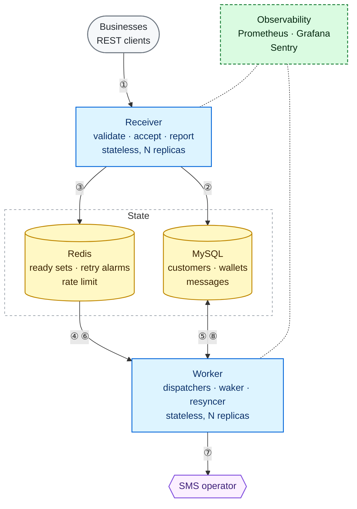
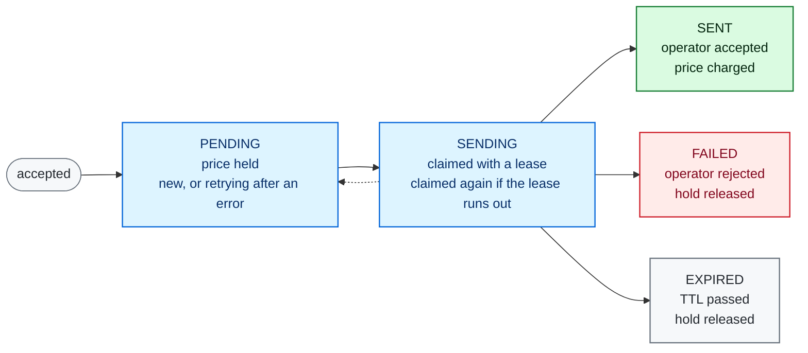
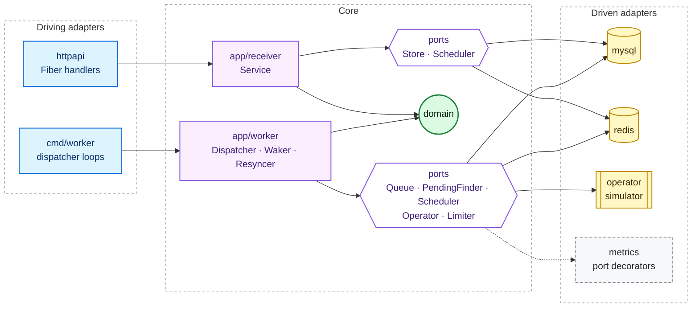
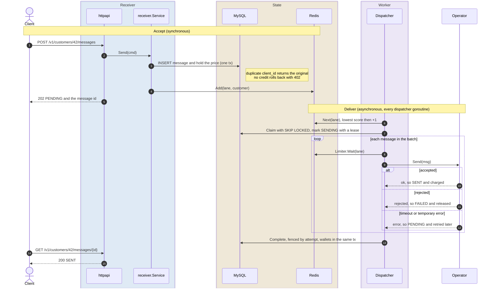

# SMS Gateway

A prepaid SMS gateway built for the ArvanCloud software developer challenge. Businesses top up a balance, send single-page SMS through a REST API (with an express lane for OTPs), and pull reports of what they sent. The target is about 100M messages a day from tens of thousands of customers with very uneven traffic.

It is one Go module with two binaries: the **receiver** (REST API) and the **worker** (delivery to the operator). MySQL is the source of truth; Redis only decides who sends next.

1. [System design](#1-system-design)
2. [Architecture](#2-architecture)
3. [Sending a message, end to end](#3-sending-a-message-end-to-end)
4. [Deployment and operations](#4-deployment-and-operations)

## 1. System design



- ① A business sends a message, or asks for its balance or a report.
- ② The receiver stores the message and holds its price in one MySQL transaction.
- ③ It puts the customer in its lane's ready set in Redis and answers `202`.
- ④ A worker takes the next customer from the ready set, in round robin.
- ⑤ It claims a batch of that customer's messages with a lease.
- ⑥ It waits for a rate-limit slot for each message.
- ⑦ It sends each message to the operator.
- ⑧ It records the outcomes and settles the wallet in one transaction.

Blue: the gateway's services. Amber: state. Purple: external. Green: observability, which scrapes metrics from every replica and collects errors.

### Components

| Component | Responsibility | State | Scaling and failure |
|---|---|---|---|
| Business (client) | Calls the REST API. Generates a `client_id` (UUID) per message so a retried request is never charged twice. | — | — |
| Receiver | Validates a send, stores the message and holds its price in one MySQL transaction, then puts the customer in its lane's ready set. Serves customers, balances and reports. | none | Stateless: run several behind a load balancer. |
| Worker | One dispatcher pool per lane. Each goroutine takes the next customer from the ready set, claims a batch of that customer's messages, sends them within the operator's rate limit and settles the outcomes. A waker brings back customers whose retry or lease time has come, every 100 ms. A resyncer re-adds customers with unfinished messages every minute, as a safety net. | none | Stateless: run several. They coordinate through MySQL row locks and Redis. A crash delays messages until their lease runs out; it never loses them. |
| MySQL | Source of truth: customers, wallets and messages. The `messages` table is both the delivery queue and the report. | durable | One primary. A send costs two statements; settling a batch costs one transaction. |
| Redis | `sms:ready:express` and `sms:ready:normal`: sorted sets of the *customers* (not messages) that have work, scored for round robin. `sms:delayed:<lane>`: customers waiting for a retry or a lease to end, scored by when they are due. Per-second counters for the operator rate limit. | disposable | Losing it costs latency, not messages: the resyncer rebuilds the ready sets from MySQL. |
| SMS operator | Accepts messages for delivery. Simulated here, with configurable latency, timeouts, rejections and temporary failures. | — | Its capacity is the global rate limit, `OPERATOR_RATE_LIMIT`. |
| Prometheus, Grafana, Sentry | Metrics, dashboard, error tracking. | — | Outside the request path. |

### Data model

| Table | Key columns | Role |
|---|---|---|
| `customers` | `id INT UNSIGNED AUTO_INCREMENT`, `name` | A business using the gateway. The server assigns the id. |
| `wallets` | `customer_id` (PK, FK), `balance`, `blocked`, `CHECK (blocked >= 0 AND balance >= blocked)` | Prepaid credit. `blocked` is the sum of prices held for messages that are not settled yet; `available = balance - blocked`. |
| `messages` | `id`, `customer_id`, `client_id BINARY(16)`, `lane`, `status`, `price`, `attempt`, `available_at`, `expires_at` | One row per SMS: the queue and the report in one table. `available_at` is the earliest time the message may be claimed (also the lease end while it is `SENDING`) and becomes `NULL` once the message is final. |

| Index on `messages` | Used by |
|---|---|
| `UNIQUE (customer_id, client_id)` | A retried send finds the original message; lookup by `client_id`. |
| `(customer_id, lane, available_at)` | A worker claims the oldest ready messages of one customer in one lane, and finds when its next message is due. |
| `(customer_id, id)` | Reports, newest first, paged with an id cursor. |
| `(lane, available_at, customer_id)` | Backlog metrics and the resyncer. Only unfinished messages have `available_at`, so the cost follows the backlog, not the table size; `customer_id` lets the resyncer read the index alone. |

### Message lifecycle



### Requirements and how they are met

| Requirement | How |
|---|---|
| ~100M SMS a day | Receiver and worker are stateless and scale out. A send is one `INSERT` and one `UPDATE`; a worker turn claims a batch in one transaction and settles it in another, with one wallet write per customer. Redis holds customers, not messages, so its size follows the number of active customers rather than the backlog. |
| Uneven traffic between customers | Workers serve customers in round robin, not messages in arrival order. A customer with a million queued messages gets one turn per round, like everyone else, so small customers are not stuck behind a campaign. |
| Express (OTP) delivery time | Express has its own ready set, its own worker goroutines, a batch size of 1, short retries, and a reserved share of the operator's capacity (`EXPRESS_RESERVED_PERCENT`) that normal traffic can't use. Its time to the operator is measured as `sms_delivery_latency_seconds{lane="express"}`. |
| Spend the whole balance, never past zero | Accepting a message holds its price with one conditional update: `blocked += price WHERE balance - blocked >= price`. Concurrent sends serialize on the wallet row; the `CHECK` constraint backs it up. The hold becomes a charge when the operator accepts the message, and is released if it fails or expires. |
| Reports | `GET /messages` filters by status and time and pages newest first on `(customer_id, id)`. Single messages can be fetched by id or by `client_id`. |
| A retried request is not charged twice | The client's `client_id` is unique per customer. The message is inserted before the hold, so a retry hits the unique index first and gets the original message back, even if the balance is now zero. |
| Crashes and timeouts | At-least-once delivery, exactly-once charging. A claim sets a lease; if the worker dies, the message is claimed again with `attempt + 1`, and settling only succeeds for the current `attempt`. |
| Redis loss | Redis only records who has work. The resyncer re-adds every customer with unfinished messages, per lane, every minute. |

### API

The full contract (schemas, validation rules, every status code, examples) is in [`api/openapi.yaml`](api/openapi.yaml) (OpenAPI 3.1).

| Method | Path | Notes |
|---|---|---|
| `POST` | `/v1/customers` | `{"name": "..."}`. Creates the customer and an empty wallet. `201`. |
| `GET` | `/v1/customers/{id}` | `id`, `name`, `created_at` |
| `POST` | `/v1/customers/{id}/topups` | `{"amount": n}` |
| `GET` | `/v1/customers/{id}/balance` | `balance`, `blocked`, `available` |
| `POST` | `/v1/customers/{id}/messages` | `client_id` (UUID), `phone`, `text`, `express`, optional `ttl_seconds`. `202`. |
| `GET` | `/v1/customers/{id}/messages` | Report. Filters: `status`, `from`, `to`, `cursor`, `limit` (max 200). |
| `GET` | `/v1/customers/{id}/messages/{messageId}` | One message with its status and attempts. |
| `GET` | `/v1/customers/{id}/messages/by-client-id/{clientId}` | The same, by the client's `client_id`. |

Errors: `400` invalid input, `402` insufficient balance, `404` unknown customer or message. Text must fit one page: 160 characters if ASCII, 70 otherwise (e.g. Persian), at the same price.

Message ids are `BIGINT` inside MySQL but leave the API encoded with [Sqids](https://sqids.org) and a private alphabet, so clients see opaque ids such as `dTXEDxnCk3` and can't infer ordering or volume. The customer id in the path stands in for authentication, which the brief puts out of scope; in production it would come from an API key.

### Limits and next steps

- Partitioning `messages`. Because `UNIQUE (customer_id, client_id)` lives on this table, it can be partitioned by `HASH(customer_id)` but not by day; time-based retention would need the key moved to its own table.
- A single customer's sends serialize on its wallet row. Grouping several holds into one transaction would raise that ceiling for very large senders.
- A read replica for reports, and streaming status events to a reporting store (e.g. ClickHouse) at full scale.
- Several operators with routing by number prefix and a circuit breaker per operator.
- Delivery reports (DLR) from the handset; `SENT` means the operator accepted the message.
- Idempotency for top-ups.

## 2. Architecture

Hexagonal: the core owns its ports (the hexagons) and imports no infrastructure; adapters implement those ports, and `cmd/*` wires them together. Arrows show calls at runtime; in the code every dependency points into the core.



```
cmd/receiver, cmd/worker      composition roots: config and wiring, one binary each
api/openapi.yaml              REST contract
internal/domain               entities, validation, domain errors; no dependencies
internal/app/receiver         use cases of the API side and the ports they need
internal/app/worker           dispatcher, waker, resyncer and the ports they need
internal/adapter/httpapi      inbound REST adapter (Fiber v3), public id encoding
internal/adapter/mysql        stores: accept, claim, settle, reports
internal/adapter/redis        ready sets (round robin) and the operator rate limiter
internal/adapter/operator     simulated operator
internal/adapter/metrics      Prometheus registry and decorators around the worker ports
internal/adapter/logging      JSON logs; errors also go to Sentry
migrations/, deploy/          schema; migrate script, Prometheus and Grafana config
docs/                         load test: write-up, k6 script, Grafana screenshot
```

## 3. Sending a message, end to end



### Receiver: accept

1. **Parse at the edge.** [`handler.send`](internal/adapter/httpapi/handlers.go#L31) decodes the body, rejecting unknown fields, and [`sendRequest.command`](internal/adapter/httpapi/dto.go#L18) parses `client_id` into a UUID. Nothing below the adapter deals with JSON.
2. **Build the message.** [`Service.Send`](internal/app/receiver/service.go#L65) picks the lane from `express`, applies the lane's price and maximum TTL, and validates the phone number and the one-page limit through [`domain.Draft`](internal/domain/draft.go).
3. **Accept in one transaction.** [`ReceiverStore.Accept`](internal/adapter/mysql/receiver_store.go#L56):

   ```sql
   INSERT INTO messages (customer_id, client_id, lane, ..., status, available_at, expires_at)
   VALUES (?, ?, ?, ..., 'PENDING', NOW, ?);

   UPDATE wallets SET blocked = blocked + :price
   WHERE customer_id = ? AND balance - blocked >= :price;
   ```

   The insert runs first, so a retry with the same `client_id` hits the unique index and returns the original message before the wallet is touched. The hold is one conditional update: concurrent sends from the same customer queue on the wallet row and can't overdraw it. If it updates no row, [`whyNoHold`](internal/adapter/mysql/receiver_store.go#L129) tells an unknown customer (`404`) from one without credit (`402`), and the transaction rolls back, so nothing is stored.
4. **Wake a worker.** [`Scheduler.Add`](internal/adapter/redis/scheduler.go#L20) adds the customer to `sms:ready:<lane>` with `ZADD NX` at the current lowest score: a new customer gets the next turn, and one already in the set keeps its place. If Redis is unavailable the send still succeeds; the resyncer adds the customer within a minute.
5. The API answers `202` with status `PENDING` and the message id.

### Worker: deliver and settle

Each worker runs `NORMAL_CONCURRENCY` and `EXPRESS_CONCURRENCY` goroutines, each looping over [`Dispatcher.tick`](internal/app/worker/dispatcher.go#L72).

6. **Pick the next customer.** [`Scheduler.Next`](internal/adapter/redis/scheduler.go#L31) takes the lowest-scored customer and increments its score instead of removing it. Every active customer gets one turn per round however large its backlog, and several goroutines can serve the same busy customer at once.
7. **Claim a batch with a lease.** [`WorkerStore.Claim`](internal/adapter/mysql/worker_store.go#L22):

   ```sql
   SELECT ... FROM messages
   WHERE customer_id = ? AND lane = ? AND available_at <= NOW
   ORDER BY available_at LIMIT :batch
   FOR UPDATE SKIP LOCKED;

   UPDATE messages SET status = 'SENDING', attempt = attempt + 1, available_at = :lease_end
   WHERE id IN (...);
   ```

   `available_at` means "not before": the accept time for a new message, the backoff time for a retry, and the lease end while `SENDING`. If the worker dies, the lease runs out and the same query claims the message again. `SKIP LOCKED` lets several goroutines claim from one customer without waiting on each other. The batch is 10 messages for normal and 1 for express.
8. **Wait for operator capacity.** [`Limiter.Wait`](internal/adapter/redis/limiter.go#L49) counts sends per second in Redis, shared by every worker. Normal traffic may use only `100 - EXPRESS_RESERVED_PERCENT` percent of each second, so a campaign can't take the capacity OTPs need.
9. **Send.** [`Dispatcher.send`](internal/app/worker/dispatcher.go#L141) turns the result into an outcome:

   | Result | Outcome | Wallet |
   |---|---|---|
   | operator accepted | `SENT` | price charged |
   | operator rejected | `FAILED` | hold released |
   | timeout or temporary error | back to `PENDING`, retried after exponential backoff capped at the TTL | still held |
   | TTL already passed | `EXPIRED` | hold released |

10. **Settle the batch in one transaction.** [`WorkerStore.Complete`](internal/adapter/mysql/worker_store.go#L45):

    ```sql
    UPDATE messages SET status = :final, available_at = NULL, sent_at = ...
    WHERE id = ? AND attempt = :claimed_attempt AND status = 'SENDING';

    -- once per customer in the batch, in customer id order
    UPDATE wallets SET balance = balance - :charged, blocked = blocked - :released
    WHERE customer_id = ?;
    ```

    `attempt` is a fencing token: if the lease ran out and the message was claimed again, the late outcome matches no row and is neither recorded nor charged. Delivery is at-least-once (a crash after the operator accepted means a resend), charging is exactly once. Wallet changes are summed per customer and applied in id order, so a batch costs one wallet write per customer and concurrent settles can't deadlock. If a message in the batch will be retried, the worker also sets an alarm for the customer at the earliest retry time.
11. **Leave the ready set when idle.** When a claim finds nothing, [`removeFromRingIfIdle`](internal/app/worker/dispatcher.go#L95) removes the customer, then asks MySQL when its next message is due. If one is ready now (it arrived in between), the customer goes straight back. If the next one is a retry or still leased to another worker, the customer gets an alarm in `sms:delayed:<lane>` for that time. Removing before checking closes the gap where a send lands between "nothing to claim" and the removal.
12. **Wake up on time.** Every 100 ms the [waker](internal/app/worker/waker.go#L37) runs a Lua script that moves customers whose alarm time has passed from `sms:delayed:<lane>` back into the ready set, at the head of the round robin.

### Safety nets

| Failure | What happens |
|---|---|
| Worker crashes mid-batch | Leases run out (1 minute normal, 15 seconds express). The next worker to visit the customer sets an alarm for the lease end, and the messages are claimed again with `attempt + 1`. |
| Operator accepted, settle failed | The message is resent after its lease; it is charged once. |
| Message waiting for a retry | Its customer waits in `sms:delayed:<lane>` until the retry time, and the waker brings it back within 100 ms of it. |
| Redis lost | Sends are still accepted; the [resyncer](internal/app/worker/resyncer.go#L37) rebuilds the ready sets from MySQL within a minute. |
| Panic in a handler or worker loop | Recovered, logged with its stack trace and sent to Sentry; the process keeps running. |

## 4. Deployment and operations

### Services

`docker-compose.yml` runs the whole system:

| Service | Image | Host port | Role |
|---|---|---|---|
| `mysql` | `mysql:9.7.4` | 3307 | Source of truth. Default durability: binlog on, flush on every commit. |
| `migrate` | `mysql:9.7.4` | — | One-shot job: applies `migrations/` to `sms` (services) and `sms_test` (integration tests). |
| `redis` | `redis:8.10.3-alpine` | 6379 | Ready sets and rate-limit windows. No persistence needed. |
| `receiver` | built from `Dockerfile` | 8080 | REST API. Metrics on `:9100`, inside the network only. |
| `worker` | built from `Dockerfile` | — | Delivery. Scale with `--scale worker=N`. |
| `prometheus` | `prom/prometheus:v3.15.1` | 9090 | Finds every receiver and worker replica through Docker DNS. |
| `grafana` | `grafana/grafana:13.3.0` | 3000 | Opens on the SMS gateway dashboard, no login. |

The `Dockerfile` builds either binary (`APP=receiver` or `APP=worker`) into a static, non-root distroless image.

### Run

You need Docker with Compose v2 to run the stack, and Go 1.26 or newer to run the tests.

```bash
make up
```

If a port is taken, override it, e.g. `HTTP_PORT=8088 PROMETHEUS_PORT=9091 make up`. Then:

```bash
curl -s -X POST localhost:8080/v1/customers -d '{"name": "Acme Shop"}'   # returns {"id": 1, ...}
curl -s -X POST localhost:8080/v1/customers/1/topups -d '{"amount": 100}'

curl -s -X POST localhost:8080/v1/customers/1/messages \
  -d '{"client_id": "3f6c1a52-9e1b-4c7d-8a2f-0d4b6e9a1c37", "phone": "+989121234567", "text": "Your code is 4821", "express": true}'

curl -s localhost:8080/v1/customers/1/messages/by-client-id/3f6c1a52-9e1b-4c7d-8a2f-0d4b6e9a1c37
curl -s 'localhost:8080/v1/customers/1/messages?status=SENT&limit=20'
curl -s localhost:8080/v1/customers/1/balance
```

`make down` stops everything and deletes the volumes.

### Scale and tune

```bash
docker compose up -d --scale worker=3
```

With the default simulator, one worker delivers about 450 normal messages a second: each goroutine sends its batch of 10 one by one, and a simulated timeout holds the whole batch for up to `NORMAL_SEND_TIMEOUT`. Size the worker count to the operator's capacity. Worker settings go in a `docker-compose.override.yml`, which Compose picks up automatically:

```yaml
services:
  worker:
    environment:
      OPERATOR_RATE_LIMIT: "2000"
      MYSQL_MAX_CONNS: "30"
```

Keep the MySQL connection total under the server's `max_connections` (151 by default): 50 for the receiver plus `MYSQL_MAX_CONNS` per worker.

### Configuration

| Variable | Default | Used by |
|---|---|---|
| `MYSQL_DSN`, `REDIS_ADDR` | local docker ports | both |
| `MYSQL_MAX_CONNS` | `50` | both |
| `PRICE_NORMAL`, `PRICE_EXPRESS` | `1`, `1` | receiver |
| `MAX_TTL_NORMAL`, `MAX_TTL_EXPRESS` | `24h`, `2m` | receiver |
| `PUBLIC_ID_ALPHABET`, `PUBLIC_ID_MIN_LENGTH` | built-in shuffled alphabet, `10` | receiver. Set your own alphabet in production and never change it, or every issued id becomes invalid. |
| `NORMAL_CONCURRENCY`, `EXPRESS_CONCURRENCY` | `64`, `32` | worker |
| `NORMAL_BATCH_SIZE`, `EXPRESS_BATCH_SIZE` | `10`, `1` | worker |
| `NORMAL_LEASE`, `EXPRESS_LEASE` | `1m`, `15s` | worker |
| `NORMAL_SEND_TIMEOUT`, `EXPRESS_SEND_TIMEOUT` | `5s`, `3s` | worker |
| `NORMAL_RETRY_BASE`/`_MAX`, `EXPRESS_RETRY_BASE`/`_MAX` | `1s`/`1m`, `200ms`/`2s` | worker |
| `OPERATOR_RATE_LIMIT` | `1000` msg/s (`0` = unlimited) | worker |
| `EXPRESS_RESERVED_PERCENT` | `20` | worker |
| `WAKE_INTERVAL` | `100ms` | worker |
| `RESYNC_INTERVAL` | `1m` | worker |
| `SIM_MIN_LATENCY`, `SIM_MAX_LATENCY` | `20ms`, `150ms` | worker |
| `SIM_TIMEOUT_RATE`, `SIM_REJECT_RATE`, `SIM_FAILURE_RATE` | `0.01`, `0.01`, `0.02` | worker |
| `METRICS_ADDR` | `:9100` | both |
| `SENTRY_DSN`, `ENVIRONMENT` | empty (Sentry off), `development` | both |

### Production notes

- **Receiver:** run several behind a load balancer and probe `GET /healthz`. On `SIGTERM` it stops accepting connections and finishes in-flight requests (up to 10 seconds).
- **Worker:** on `SIGTERM` it stops claiming and finishes the batch in hand, including its settlement; anything left over is claimed again after its lease.
- **MySQL:** keep the durable defaults (binlog, flush per commit): the wallet is money. Put reports on a replica as traffic grows.
- **Redis:** needs no persistence or backup; it is rebuilt from MySQL.
- **Secrets and ids:** set `PUBLIC_ID_ALPHABET` once, set `SENTRY_DSN`, and keep the metrics port off the public network.
- **Migrations:** `migrations/*.sql` are idempotent (`CREATE ... IF NOT EXISTS`) and applied by the `migrate` job before the services start.

### Observability

Each service serves Prometheus metrics on `METRICS_ADDR`, separate from the public API. Grafana's SMS gateway dashboard shows delivery, queue, API, operator and runtime panels.

| Metric | Type | Labels | Meaning |
|---|---|---|---|
| `sms_http_request_duration_seconds` | histogram | method, route, status | API response time and request rate |
| `sms_outcomes_total` | counter | lane, outcome | sent, failed, expired, retry, stale, error |
| `sms_delivery_latency_seconds` | histogram | lane | accepted → handed to the operator; the express SLA |
| `sms_backlog_messages` | gauge | lane | messages not yet final |
| `sms_backlog_oldest_seconds` | gauge | lane | age of the oldest message ready to send |
| `sms_ready_customers` | gauge | lane | customers waiting in the round robin |
| `sms_operator_request_duration_seconds` | histogram | lane, result | operator response time: accepted, rejected, timeout, error |
| `sms_limiter_wait_seconds` | histogram | lane | time waiting for operator capacity |
| `sms_claim_batch_size` | histogram | lane | messages claimed per worker turn |
| `go_*`, `process_*`, `go_sql_*` | — | — | runtime, process and MySQL pool stats |

Worker metrics come from decorators around its ports, applied in `cmd/worker`, so the use cases have no metrics code. No metric is labelled by customer: tens of thousands of customers would explode Prometheus' series count; per-customer data lives in the reports API.

When `SENTRY_DSN` is set, every Error-level log line goes to Sentry with its fields: 500s, database or Redis failures, failed settles and recovered panics. Expected outcomes (`400`, `402`, operator rejections, reclaimed messages) log at Warn or below and are not sent.

### Load test

A 10-minute run on a laptop held about 1,120 messages a second (the brief's 100M a day) and then a 1,620/s burst, with no failed requests, p95 9.6 ms, and the money reconciling exactly across 585k messages. During the burst, small customers and OTPs kept sub-second delivery while the campaign senders waited for their own backlog. The profile, Grafana screenshot, results, conditions and k6 script are in [docs/load-test.md](docs/load-test.md).

### Tests

```bash
make test               # unit tests
make test-integration   # needs `make up`; runs the store tests against MySQL
```

The integration tests use their own database, `sms_test`, so running workers never touch test data. They include the key correctness check: 300 concurrent sends against a balance of 100 must accept exactly 100.
