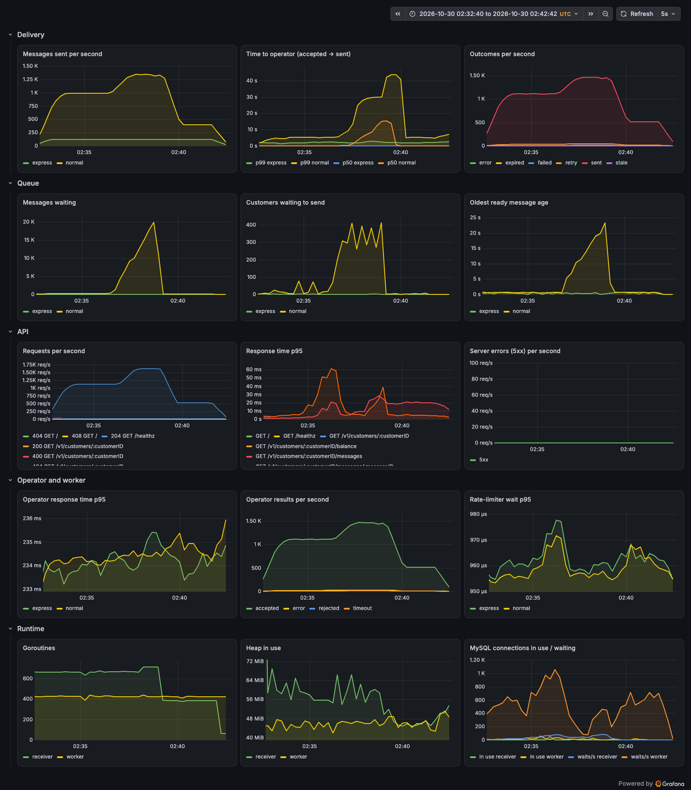

# Load test

One 10-minute [k6](https://k6.io) run ([`load-test.js`](load-test.js)) against the compose stack on a laptop (Docker Desktop on macOS, 8 GB VM), with 3 workers and the worker override from the README (`OPERATOR_RATE_LIMIT=2000`, `MYSQL_MAX_CONNS=30`). 3,350 customers with very uneven traffic:

| Traffic | Customers | Rate |
|---|---|---|
| Campaigns, normal lane | 50 | ramp to 600 msg/s and hold for 3 minutes, burst to 1,100 msg/s for 2 minutes, then stop |
| Small businesses, normal lane | 3,000 | 400 msg/s throughout |
| OTPs, express lane | 300 | 120 msg/s throughout |
| Reports, `GET /messages` | — | 20 req/s |

The gateway takes about 1,120 messages a second for 3 minutes (the brief's 100M a day), then about 1,620 a second for 2 minutes, more than three workers can deliver.



## Results

| Result | |
|---|---|
| API | 603,440 requests, none failed, no 5xx. p95 9.6 ms, p99 96 ms (measured by k6). |
| Messages | 585,339 accepted: 579,182 `SENT`, 6,157 `FAILED` (the simulator rejects 1%), none expired or left behind. |
| Money | Across the 3,350 wallets, the amount spent equals the price of the sent messages (579,182); nothing is still held and no wallet is below zero. |
| Throughput | The normal lane delivered up to ~1,350 messages a second. During the burst its backlog peaked at 20k and drained about 20 seconds after the burst ended. |

Time from accept to operator, per group (`sent_at - created_at` in MySQL, worst minute of each phase):

| Phase | OTP p50 / p95 | Small customers p50 / p95 | Campaign customers p50 / p95 |
|---|---|---|---|
| Steady, ~1,120 msg/s | 0.10 s / 0.22 s | 0.10 s / 0.24 s | 0.10 s / 0.32 s |
| Burst, ~1,620 msg/s | 0.10 s / 0.24 s | 0.14 s / 0.81 s | 16.4 s / 22.8 s |

During the burst only the campaign senders wait, for their own backlog. Small customers still get their messages out in under a second and OTPs are unaffected, because workers take turns by customer and express has its own workers and reserved capacity. The p99 of every group is a few seconds: the simulator times out 1% of calls, and those messages are retried.

## Conditions

Docker Desktop's virtual disk on macOS occasionally takes seconds to complete an fsync (7.6 s at worst, about 1 ms on average, measured in `performance_schema`). With MySQL's durable defaults every commit waits for it and the API stalls for those seconds, so for this run MySQL flushed once a second instead (`innodb_flush_log_at_trx_commit = 2`, `sync_binlog = 0`; the binlog stayed on). Keep the defaults in production, where fsync takes about a millisecond. Other containers on the Docker VM were stopped during the run, because the 8 GB VM ran out of memory with them.

## Running it

With the worker override from the README in `docker-compose.override.yml`:

```bash
docker compose up -d --scale worker=3
docker compose exec mysql mysql -uroot -proot -e "SET GLOBAL innodb_flush_log_at_trx_commit = 2; SET GLOBAL sync_binlog = 0"
docker run --rm --network sms-gateway_default -v "$PWD/docs:/scripts:ro" grafana/k6:2.3.0 run /scripts/load-test.js
```

The second command is only needed on Docker Desktop; restarting MySQL brings the durable defaults back. Watch the run on the Grafana dashboard at `localhost:3000`.
